<!-- SECTION: backend.overview | status: DRAFT-UNVERIFIED -->
## Service overview

Prooflyt backend is the system of record for a multi-tenant privacy/compliance
management platform. Responsibility is derived from the eight epics supplied
in `stories.md` and reinforced by the change request in `feedback.md`:

| Epic | Responsibility | Source |
|---|---|---|
| EP-001 | Audit trail: capture, browse, filter, export, and verify integrity of an append-style log of system/user actions | US-001-01, US-001-02, CR-101 (logout entries) |
| EP-002 | Identity & access: authentication, session lifecycle, account lockout, role/permission administration, tenant onboarding, user self-service profile | US-002-01 … US-002-07, feedback.md CR-98, AC-002-05-01/02/03 |
| EP-003 | Breach incident management: reporting, impact assessment, task assignment, evidence capture | US-003-01 … US-003-04, BR-001 |
| EP-004 | Data source intake and column-level data classification, compliance register of processing activities | US-004-01 … US-004-03, BR-003 |
| EP-005 | Data subject rights (DSR) case management with SLA-bound tasks | US-005-01, US-005-02, BR-005, NFR-001 |
| EP-006 | Privacy notice authoring, approval workflow, supporting evidence | US-006-01 … US-006-03, BR-002 |
| EP-007 | Retention rule configuration and legal-hold enforcement | US-007-01, US-007-02 |
| EP-008 | Data processor tracking: DPA status and purge acknowledgements | US-008-01, US-008-02 |

The one concretely specified, acceptance-criteria-backed piece of work in this
run is the account-lockout feature from `feedback.md` change request CR-98:
five consecutive failed sign-in attempts lock an account for 15 minutes, with
an audit log entry recorded on lockout (AC-002-05-01, AC-002-05-02,
AC-002-05-03, confirmed verbatim in `design-brief.md`). Change request CR-101
(`feedback.md`) adds a second grounded behaviour: each user logout writes an
audit log entry, and a logout that fails to complete writes none (US-009-03,
AC-009-03-01, AC-009-03-02, AC-009-03-03). Every other epic above is
represented in the inputs only by a story title with an empty "so that"
clause and no acceptance criteria - see `backend.coverage` for the resulting
gap register.

**Explicitly not this service's responsibility:**
- Any UI, screen, layout or client-side rendering (role boundary, core rule B9).
- Outbound notification/email/SMS delivery - no input describes a delivery
  channel, recipient policy, or template for any event (lockout, logout, breach,
  DSR deadline, or otherwise). Raised as **GAP-BE-001**: no input specifies
  whether any of the above events must trigger a human-facing notification;
  closing artifact - a notification requirements document or an explicit
  "no notifications in v1" decision.
- File/object storage infrastructure choice (EP-004 uploads, EP-003/EP-006
  evidence) - see **GAP-BE-002** in `backend.data-lifecycle`.

<!-- /SECTION: backend.overview -->
<!-- SECTION: backend.domain-model | status: DRAFT-UNVERIFIED -->
## Domain model

Entities below are named directly from epic/story nouns. Relationships marked
`[DERIVED]` follow necessarily from the cited story; relationships marked
`[ASM-BE-nnn]` are my working assumption because no input states the
cardinality or ownership explicitly.

```mermaid
erDiagram
    TENANT ||--o{ USER : "has (US-002-04) [DERIVED]"
    USER ||--o{ SESSION : "opens (US-002-05/06) [DERIVED]"
    USER ||--|| LOGIN_LOCKOUT_STATE : "has one (AC-002-05-01) [ASM-BE-001]"
    USER }o--o{ ROLE : "assigned (US-002-01/02) [DERIVED]"
    ROLE ||--o{ PERMISSION : "grants (US-002-01/02) [DERIVED]"
    TENANT ||--o{ AUDIT_LOG_ENTRY : "scopes (NFR-002) [DERIVED]"
    USER ||--o{ AUDIT_LOG_ENTRY : "actor of (AC-002-05-03) [DERIVED]"
    USER ||--o{ AUDIT_LOG_ENTRY : "actor of logout (AC-009-03-01, CR-101) [DERIVED]"
    SESSION ||--o| AUDIT_LOG_ENTRY : "ended by logout, one entry (AC-009-03-01) [DERIVED]"
    TENANT ||--o{ BREACH_INCIDENT : "scopes [ASM-BE-002]"
    BREACH_INCIDENT ||--o{ BREACH_TASK : "has (US-003-02) [DERIVED]"
    BREACH_INCIDENT ||--o{ BREACH_EVIDENCE : "has (US-003-03) [DERIVED]"
    BREACH_INCIDENT ||--|| BREACH_IMPACT_ASSESSMENT : "has one (US-003-01) [ASM-BE-003]"
    TENANT ||--o{ DATA_SOURCE : "scopes [ASM-BE-002]"
    DATA_SOURCE ||--o{ DATA_SOURCE_COLUMN : "has (US-004-02/03) [DERIVED]"
    TENANT ||--o{ COMPLIANCE_REGISTER_ENTRY : "scopes [ASM-BE-002]"
    COMPLIANCE_REGISTER_ENTRY }o--o{ DATA_SOURCE : "references [GAP-BE-016]"
    TENANT ||--o{ DSR_CASE : "scopes [ASM-BE-002]"
    DSR_CASE ||--o{ DSR_TASK : "has (US-005-02) [DERIVED]"
    USER ||--o{ DSR_CASE : "handles (US-005-01) [DERIVED]"
    TENANT ||--o{ PRIVACY_NOTICE : "scopes [ASM-BE-002]"
    PRIVACY_NOTICE ||--o{ NOTICE_EVIDENCE : "has (US-006-03) [DERIVED]"
    USER ||--o{ PRIVACY_NOTICE : "authors/approves (US-006-01/02) [DERIVED]"
    TENANT ||--o{ RETENTION_RULE : "scopes [ASM-BE-002]"
    RETENTION_RULE }o--o{ DATA_SOURCE : "targets [GAP-BE-017]"
    TENANT ||--o{ LEGAL_HOLD : "scopes [ASM-BE-002]"
    TENANT ||--o{ PROCESSOR : "scopes [ASM-BE-002]"
    PROCESSOR ||--o{ PROCESSOR_DPA : "tracked by (US-008-02) [GAP-BE-018 on cardinality]"
    PROCESSOR ||--o{ PURGE_ACKNOWLEDGEMENT : "has (US-008-02) [DERIVED]"
```



**Logout audit entry (CR-101).** Each logout produces exactly one
`AUDIT_LOG_ENTRY` with event type `logout`, recording the user, the tenant, and
the logout timestamp (AC-009-03-01; event type per AC-009-03-03). The entry and
the session termination commit together or not at all: AC-009-03-02 requires
that a logout which fails to complete writes no logout audit entry for that
request. The entry is created in the same unit of work as the session
termination. The failure itself is recorded in the operational log, not the
audit trail (see `backend.observability`).

**ASM-BE-001** - AC-002-05-01/02/03 say "account" where the story (US-002-05)
says "user." I assume Account and User are the same credential-bearing
record for the purpose of lockout state, one lockout-state record per user.
Confirming artifact: a stakeholder statement distinguishing Account from User,
or confirmation they are identical.

**ASM-BE-002** - Multi-tenancy is explicit in US-002-04 ("tenant users") and
NFR-002 ("tenant-scoped"). No input states whether every other entity
(breach, data source, DSR case, notice, retention rule, processor) is
tenant-scoped, but a single-tenant reading of a compliance platform handling
multiple organisations' data would contradict the product framing, so I
assume tenant scoping is universal. Confirming artifact: an explicit
multi-tenancy policy.

**ASM-BE-003** - US-003-01 ("capture breach impact assessment details") is
modelled as a single assessment record per incident, not a versioned
history, because no input mentions revision or multiple assessments.

**GAP-BE-016** - No input states how `ComplianceRegisterEntry` (US-004-01)
relates to `DataSource` (US-004-02/03) - same register populated by upload,
or two independent artefacts. Closing artifact: a description of EP-004's
end-to-end flow.

**GAP-BE-017** - US-007-01/02 name retention rules and legal holds but never
state what they apply to (a `DataSource`, a `DataSourceColumn`, a retention
category, or a data subject). Closing artifact: retention rule requirements.

**GAP-BE-018** - US-008-02 implies DPA and purge-acknowledgement tracking per
processor but does not state whether a processor has one current DPA or a
versioned history of DPAs. Closing artifact: processor lifecycle description.

**Contradiction check (core rule 8).** All four directions were checked:
story↔design (design-brief.md content is the same AC text as stories.md -
consistent, no conflict), story↔requirement (requirements.md duplicates
stories.md plus BR-/NFR- entries - consistent), requirement↔requirement
(BR-004 "password policy at credential/token layer" and CR-98's lockout are
complementary, not conflicting), design↔design (n/a, single design-adjacent
input). No contradiction found in the domain model itself. Several stories are
redundant at different granularities (e.g. US-001-01/US-001-02, US-002-01/US-002-02,
US-002-03/US-002-07, US-003-01…04, US-004-02/US-004-03, US-005-01/US-005-02,
US-006-01/US-006-02) - this is duplication, not contradiction, and is
resolved in `backend.coverage` by mapping overlapping stories to one module.
The story-identifier mismatch between this document and the current
`stories.md` is recorded as **CON-BE-001** in `backend.coverage`.

<!-- /SECTION: backend.domain-model -->
<!-- SECTION: backend.module-map | status: DRAFT-UNVERIFIED -->
## Module map

| Module | Boundary | Depends on |
|---|---|---|
| `IDENTITY` | Tenants, users, roles/permissions, sessions, credentials, login-attempt tracking and lockout, logout | `AUDIT` (appends logout entries, CR-101 - see ASM-BE-009) |
| `AUDIT` | Append-only log of system/user events; browse, filter, export, integrity verification | `IDENTITY` (actor identity on every entry) |
| `BREACH` | Breach incidents, impact assessments, tasks, evidence | `IDENTITY`, `AUDIT` |
| `DATA-CLASS` | Data source upload, column classification, compliance register | `IDENTITY`, `AUDIT` |
| `RIGHTS` | DSR cases and tasks | `IDENTITY`, `AUDIT` |
| `NOTICE` | Privacy notice authoring, approval, evidence | `IDENTITY`, `AUDIT` |
| `RETENTION` | Retention rule configuration, legal holds | `IDENTITY`, `AUDIT`, `DATA-CLASS` [ASM-BE-004: retention targets data sources, per GAP-BE-017] |
| `PROCESSOR` | Processor registry, DPA status, purge acknowledgements | `IDENTITY`, `AUDIT` |
| `SLA-SWEEP` (cross-cutting scheduled job, not a resource owner) | Enforces time-bound deadlines per BR-005/NFR-001 | reads from `RIGHTS`, `BREACH` |

Dependency direction is one-way as listed (left depends on right), with one
exception introduced by CR-101: `IDENTITY` and `AUDIT` now depend on each
other. `AUDIT` depends on `IDENTITY` for actor identity; `IDENTITY` depends on
`AUDIT` to append logout entries. This is recorded as **ASM-BE-009** and
requires a human decision (see below). `SLA-SWEEP` is a job, not an
API-owning module - it has no `API-` IDs of its own but writes state into
`RIGHTS` and `BREACH` records it sweeps.

**ASM-BE-004** - follows GAP-BE-017 above and will be revisited once retention
scope is confirmed.

**ASM-BE-009** - CR-101 requires the logout path (IDENTITY) to write an audit
entry (AUDIT). I assume `AUDIT` exposes an internal append operation that
`IDENTITY` calls within the logout unit of work, and that `AUDIT` continues to
depend on `IDENTITY` only for actor identifiers. This creates a two-way
module dependency, which the one-way rule above does not permit. Confirming
artifact: a decision on whether the logout entry is written by `IDENTITY` via
`AUDIT`'s append operation, or whether `AUDIT` subscribes to logout events
owned by `IDENTITY`. Either choice must preserve the atomicity in
`backend.domain-model`.

<!-- /SECTION: backend.module-map -->
<!-- SECTION: backend.api-surface | status: DRAFT-UNVERIFIED -->
## API surface index

Every endpoint below is my own design as contract author (core rule B1), derived
from the verb/noun in its source story. None of these paths, methods, or
status-code choices exist in any supplied `api_docs` - there are none - so
every row is a new design decision, not a verified external fact. Rows for
`IDENTITY`/`AUDIT` (lockout feature and logout audit, CR-101) are backed by explicit acceptance
criteria; all other rows rest on a title-only story and are correspondingly
weaker - see the `Basis` column. Full per-endpoint contracts (request/response
schemas, error tables, idempotency, pagination) belong in module-level specs,
not produced in this run.

| API ID | Method | Path | Auth | Module | Basis |
|---|---|---|---|---|---|
| `API-AUTH-001@1` | POST | `/auth/sessions` | none (credentials in body) | IDENTITY | US-002-05/06, AC-002-05-01 - DERIVED |
| `API-AUTH-002@1` | DELETE | `/auth/sessions/{sessionId}` | bearer | IDENTITY | US-002-05/06 - DERIVED; logout writes audit entry per US-009-03, AC-009-03-01/02 (CR-101) |
| `API-AUTH-003@1` | POST | `/auth/sessions/refresh` | refresh token | IDENTITY | US-002-05 ("session refresh") - DERIVED |
| `API-USER-001@1` | GET | `/users/{id}` | bearer, self or Admin | IDENTITY | US-002-03/07 - DERIVED |
| `API-USER-002@1` | PATCH | `/users/{id}` | bearer, self or Admin | IDENTITY | US-002-03/07 - DERIVED |
| `API-USER-003@1` | GET | `/users/{id}/activity` | bearer, self or Admin | IDENTITY | US-002-03 ("activity history") - DERIVED |
| `API-TENANT-001@1` | POST | `/tenants/{tenantId}/users` | bearer, Admin | IDENTITY | US-002-04 - DERIVED |
| `API-ROLE-001@1` | GET | `/roles` | bearer, Admin | IDENTITY | US-002-01/02 - DERIVED |
| `API-ROLE-002@1` | PUT | `/roles/{roleId}/permissions` | bearer, Admin | IDENTITY | US-002-01/02 - DERIVED; see GAP-BE-012 |
| `API-AUDIT-001@1` | GET | `/audit-log` | bearer, Admin | AUDIT | US-001-01/02 - DERIVED |
| `API-AUDIT-002@1` | GET | `/audit-log/export` | bearer, Admin | AUDIT | US-001-01/02 - DERIVED; export format unstated, GAP-BE-019 |
| `API-AUDIT-003@1` | GET | `/audit-log/integrity` | bearer, Admin | AUDIT | US-001-02 ("verify audit log integrity") - ASM-BE-005 on mechanism |
| `API-BREACH-001@1` | POST | `/breach-incidents` | bearer, Staff/Admin | BREACH | US-003-03/04 - DERIVED |
| `API-BREACH-002@1` | PATCH | `/breach-incidents/{id}` | bearer, Staff/Admin | BREACH | US-003-03/04 - DERIVED |
| `API-BREACH-003@1` | PUT | `/breach-incidents/{id}/impact-assessment` | bearer, Staff/Admin | BREACH | US-003-01 - DERIVED |
| `API-BREACH-004@1` | POST | `/breach-incidents/{id}/tasks` | bearer, Staff/Admin | BREACH | US-003-02 - DERIVED |
| `API-BREACH-005@1` | PATCH | `/breach-incidents/{id}/tasks/{taskId}` | bearer, assignee or Admin | BREACH | US-003-02 - DERIVED |
| `API-BREACH-006@1` | POST | `/breach-incidents/{id}/evidence` | bearer, Staff/Admin | BREACH | US-003-03 - DERIVED |
| `API-DATASRC-001@1` | POST | `/data-sources` | bearer, Admin/ComplianceOfficer | DATA-CLASS | US-004-02/03 - DERIVED |
| `API-DATASRC-002@1` | GET | `/data-sources/{id}/columns` | bearer, Admin/ComplianceOfficer | DATA-CLASS | US-004-02/03 - DERIVED |
| `API-DATASRC-003@1` | PATCH | `/data-sources/{id}/columns/{columnId}` | bearer, Admin/ComplianceOfficer | DATA-CLASS | US-004-02/03 - DERIVED |
| `API-COMPLIANCE-001@1` | GET | `/compliance-register` | bearer, ComplianceOfficer/Admin | DATA-CLASS | US-004-01 - DERIVED |
| `API-COMPLIANCE-002@1` | POST | `/compliance-register` | bearer, ComplianceOfficer/Admin | DATA-CLASS | US-004-01 - DERIVED; relation to data source per GAP-BE-016 |
| `API-DSR-001@1` | POST | `/dsr-cases` | bearer, Handler/Admin | RIGHTS | US-005-01/02 - DERIVED |
| `API-DSR-002@1` | PATCH | `/dsr-cases/{id}` | bearer, Handler/Admin | RIGHTS | US-005-01/02 - DERIVED |
| `API-DSR-003@1` | POST | `/dsr-cases/{id}/tasks` | bearer, Handler/Admin | RIGHTS | US-005-02 - DERIVED |
| `API-NOTICE-001@1` | POST | `/privacy-notices` | bearer, Author role | NOTICE | US-006-01/02 - DERIVED |
| `API-NOTICE-002@1` | POST | `/privacy-notices/{id}/submit` | bearer, Author role | NOTICE | US-006-01/02 - DERIVED |
| `API-NOTICE-003@1` | POST | `/privacy-notices/{id}/approve` | bearer, Approver role | NOTICE | US-006-02 - DERIVED; segregation of author/approver is ASM-BE-006 |
| `API-NOTICE-004@1` | POST | `/privacy-notices/{id}/evidence` | bearer, Author role | NOTICE | US-006-03 - DERIVED |
| `API-RETENTION-001@1` | POST | `/retention-rules` | bearer, ComplianceOfficer/Admin | RETENTION | US-007-01/02 - DERIVED; target entity per GAP-BE-017 |
| `API-RETENTION-002@1` | POST | `/legal-holds` | bearer, ComplianceOfficer/Admin | RETENTION | US-007-02 - DERIVED |
| `API-PROCESSOR-001@1` | GET | `/processors` | bearer, ComplianceOfficer/Admin | PROCESSOR | US-008-01/02 - DERIVED |
| `API-PROCESSOR-002@1` | PATCH | `/processors/{id}/dpa` | bearer, ComplianceOfficer/Admin | PROCESSOR | US-008-02 - DERIVED; cardinality per GAP-BE-018 |
| `API-PROCESSOR-003@1` | POST | `/processors/{id}/purge-acknowledgements` | bearer, ComplianceOfficer/Admin | PROCESSOR | US-008-02 - DERIVED |

**ASM-BE-005** - "verify audit log integrity" (US-001-02) is assumed to mean a
hash-chain or checksum verification endpoint; no input states the
mechanism. Confirming artifact: integrity mechanism specification.

**ASM-BE-006** - Author and Approver are assumed to be distinct roles for
privacy notices (segregation of duties), inferred from "drafts and submits
... for approval" (US-006-01) implying a separate approval actor. No input
names the approver role explicitly.

**GAP-BE-019** - Audit export format (CSV, JSON, both) is not stated anywhere.
Closing artifact: export requirement detail.

No `GET` collection endpoint above states pagination, sorting or filter
parameters (B6 item 8) - that detail is explicitly deferred to module-level
specs, which are out of scope for this run.

<!-- /SECTION: backend.api-surface -->
<!-- SECTION: backend.auth-model | status: DRAFT-UNVERIFIED -->
## Auth model

**No input enumerates a fixed role catalogue.** US-002-01 ("Admin configures
role permission matrix") and US-002-02 ("Administer roles and granular
permission matrix") indicate permissions are **administrator-configurable at
runtime**, not a static table this spec can fully pre-populate. This is
**GAP-BE-012**: no seed/default role set or default permission matrix is
supplied. Closing artifact: a role catalogue and default-permission decision
from the product owner.

What follows is the role set inferable from actor nouns actually used in the
story text, each marked with its source, plus a provisional module-level
permission matrix. Treat every cell as `ASM-BE-007` pending GAP-BE-012
closure.

| Role (inferred) | Source |
|---|---|
| `Admin` | US-001-01, US-002-01, US-002-02, US-002-04 |
| `User` (self-service) | US-002-03, US-002-07, US-009-03 (logout of own session, CR-101) |
| `Staff` | US-003-04 |
| `Handler` | US-005-01 |
| `ComplianceOfficer` | US-004-01 (unnamed but implied owner of compliance register), US-007-01, US-008-01 |
| `Author` / `Approver` (privacy notice) | US-006-01, US-006-02 (ASM-BE-006) |

Provisional permission matrix (module × role × operation; `Y` = permitted,
`-` = not permitted, `?` = undetermined pending GAP-BE-012):

| Module | Admin | User | Staff | Handler | ComplianceOfficer | Author/Approver |
|---|---|---|---|---|---|---|
| IDENTITY (own profile) | Y (all) | Y (self only) | Y (self only) | Y (self only) | Y (self only) | Y (self only) |
| IDENTITY (role/tenant admin) | Y | - | - | - | - | - |
| AUDIT | Y | - | ? | ? | ? | - |
| BREACH | Y | - | Y | - | ? | - |
| DATA-CLASS | Y | - | - | - | Y | - |
| RIGHTS | Y | - | - | Y | ? | - |
| NOTICE | Y | - | - | - | - | Y (role-split per op, ASM-BE-006) |
| RETENTION | Y | - | - | - | Y | - |
| PROCESSOR | Y | - | - | - | Y | - |

Ownership predicate for self-service operations (`API-USER-001/002/003@1`):
the requesting user's ID must equal the resource's `{id}` path parameter, or
the requester holds `Admin`. No input states an exception to this, so none is
assumed.

Account lockout (CR-98) has no role dependency: the rule applies uniformly to
every account regardless of role, per AC-002-05-01, which names no role
exception. Logout (CR-101) likewise applies to every authenticated user for
their own session. The logout audit entry is a system-side write performed as
part of `API-AUTH-002@1`; it does not grant any role write access to `AUDIT`,
and `AUDIT` read access is unchanged.

<!-- /SECTION: backend.auth-model -->
<!-- SECTION: backend.data-lifecycle | status: DRAFT-UNVERIFIED -->
## Data lifecycle

| Data | Stored by | Retention | Encrypted at rest | Deletion |
|---|---|---|---|---|
| User credentials, session tokens | IDENTITY | not stated - **GAP-BE-010** | not stated - **GAP-BE-011** | not stated; session ended on logout (AC-009-03-01 implies termination) |
| Failed-login-attempt counter + lockout timestamp | IDENTITY | cleared on successful login or 15-min expiry (ASM-BE-003, derived from AC-002-05-02); no stated long-term retention | GAP-BE-011 | cleared, not deleted as a distinct record (ASM-BE-001) |
| Audit log entries (incl. lockout entries, AC-002-05-03, and logout entries, AC-009-03-01/03) | AUDIT | not stated - **GAP-BE-013** (a compliance audit trail is conventionally retained long-term, but no input states a duration, so no duration is assumed) | GAP-BE-011 | not stated |
| Operational failure log for logout failures (AC-009-03-02) | not stated - **GAP-BE-024** | not stated | GAP-BE-011 | not stated |
| User profile (incl. avatar, activity history) | IDENTITY | not stated | GAP-BE-011 | not stated |
| Breach incident records, impact assessments, evidence | BREACH | not stated | GAP-BE-011 | not stated |
| Data source samples, column classifications | DATA-CLASS | not stated | GAP-BE-011 | not stated |
| Compliance register entries | DATA-CLASS | not stated | GAP-BE-011 | not stated |
| DSR case data (subject requests - PII-bearing by nature) | RIGHTS | not stated - likely governed by RETENTION module (BR-005/NFR-001 SLA sweep concerns timing only, not retention) | GAP-BE-011 | not stated |
| Privacy notices, notice evidence | NOTICE | not stated | GAP-BE-011 | not stated |
| Retention rules, legal holds | RETENTION | n/a (these are the policy, not the governed data) | GAP-BE-011 | not stated |
| Processor records, DPAs, purge acknowledgements | PROCESSOR | not stated | GAP-BE-011 | not stated |

**GAP-BE-010** - No input states session/credential retention or token
lifetime. Closing artifact: session management requirements.

**GAP-BE-011** - No input states encryption-at-rest for any entity. Per core
rule 12, this is never assumed; every row above is unencrypted-by-silence
until a security requirements document states otherwise.

**GAP-BE-013** - No input states audit log retention duration, nor whether it
is append-only/WORM. AC-002-05-03 and AC-009-03-01 only require that an entry be
*created*, not how long it persists.

**GAP-BE-024** - AC-009-03-02 requires that a failed logout be "logged", but no
input names the destination, format or retention of that operational record,
nor whether it is distinct from the audit trail. Closing artifact: a logging
requirements decision (see `backend.observability`).

**GAP-BE-002** - No input names a file/object storage mechanism for breach
evidence (US-003-03), notice evidence (US-006-03), or data source uploads
(US-004-02/03). Closing artifact: infrastructure/platform decision.

PII fields that will appear across these entities (user email/phone, DSR
subject identity, breach-affected individuals' data) are masked in every
example in this and downstream specs per the standing constraint in core rule
12; no input states a masking format, so the exact mask pattern is itself
**GAP-BE-014**.

<!-- /SECTION: backend.data-lifecycle -->
<!-- SECTION: backend.nfr | status: DRAFT-UNVERIFIED -->
## Non-functional requirements

Two NFRs were supplied, both named but with an empty `target_metric` field in
the source document:

| ID | Statement | Priority | Target | Source |
|---|---|---|---|---|
| NFR-001 | Automated SLA sweeping for time-bound cases | Should | not stated - **GAP-BE-008** (no cadence, e.g. "every 5 minutes," is given) | NFR-001, relates to BR-005, EP-005, EP-003 |
| NFR-002 | Tenant-scoped WebSocket event streaming | Should | not stated - **GAP-BE-009** (no connection count, message latency, or fan-out limit given) | NFR-002, EP-001 |

No input states any latency, throughput, concurrency, or availability target
for any endpoint, including the lockout path (`API-AUTH-001@1`) and the logout
path (`API-AUTH-002@1`, CR-101). None is invented (core rule B9 forbids
fabricating NFR figures). This entire category is **GAP-BE-015**: closing
artifact is a non-functional requirements document with measurable targets.

<!-- /SECTION: backend.nfr -->
<!-- SECTION: backend.error-model | status: DRAFT-UNVERIFIED -->
## Error model

As contract author, the envelope and status-code policy below are this
service's own design, not a restated external fact. They are scoped to what
the inputs actually require; the registry will grow as module-level specs are
written.

**Envelope** (applies to every non-2xx response):

```json
{
  "error": {
    "code": "ACCOUNT_LOCKED",
    "message": "human-readable, non-sensitive",
    "details": {}
  }
}
```

**Status-code policy:**
- `4xx` - caller error (bad input, unauthenticated, unauthorized, not found,
  conflict, locked, rate-limited).
- `5xx` - server fault. No client-caused `5xx` is ever returned.
- Validation failures return `422` with per-field detail in `details`.

**Error-code registry (seeded from what the inputs require):**

| Code | HTTP status | Trigger | Source |
|---|---|---|---|
| `AUTH_INVALID_CREDENTIALS` | 401 | Username/password mismatch on `API-AUTH-001@1`, attempts 1-4 | AC-002-05-01 (implicit: failures are counted, so a distinguishable failure response must exist) |
| `AUTH_ACCOUNT_LOCKED` | 423 | 5th consecutive failed attempt, or any attempt while a lockout is active | AC-002-05-01 - "rejected with a lockout message" |
| `AUTH_SESSION_EXPIRED` | 401 | Expired/invalid session or refresh token on `API-AUTH-003@1` | ASM-BE-008 (session refresh implies an expiry concept; no input states its duration - see GAP-BE-010) |
| `VALIDATION_ERROR` | 422 | Malformed/missing required field on any write endpoint | DERIVED - standard write-path behaviour, not module-specific |
| `NOT_FOUND` | 404 | Path references a resource that does not exist or is outside the caller's tenant | ASM-BE-002 (tenant scoping) |
| `FORBIDDEN` | 403 | Caller lacks the permission for the operation | `backend.auth-model` |
| `RATE_LIMITED` | 429 | reserved; no rate-limit class is defined by any input - **GAP-BE-020** |

**Logout failure (CR-101).** AC-009-03-02 specifies the observable outcome of a
failed logout (no logout audit entry, failure logged) but does not specify the
response returned to the caller or an error code for it. No code is registered
here. Closing artifact: the logout error response, raised as **GAP-BE-024**
together with the logging decision in `backend.observability`.

Choosing `423 Locked` for `AUTH_ACCOUNT_LOCKED` is a design decision, not a
fact from an input; no input names an HTTP status for this case. Full error
tables for every other endpoint in `backend.api-surface` are deferred to
module-level specs.

<!-- /SECTION: backend.error-model -->
<!-- SECTION: backend.observability | status: DRAFT-UNVERIFIED -->
## Observability

**Logged (grounded):** every lockout event writes an `AUDIT_LOG_ENTRY` with
account, timestamp, and failed-attempt count - and nothing more, per
`feedback.md` preflight answer to "audit-log-target": *"Keep it minimal."*
This answer is treated as a settled decision, not a default awaiting
confirmation.

**Logged (grounded, CR-101):** every successful logout writes an
`AUDIT_LOG_ENTRY` with event type `logout`, the user, the tenant, and the
logout timestamp (AC-009-03-01, AC-009-03-03). The same "keep it minimal"
answer is applied: no further fields are added to the logout entry.

**Failure logging (grounded, CR-101):** a logout that fails to complete writes
no audit entry and the failure is logged (AC-009-03-02). This operational record
is separate from the audit trail. Its destination, format and retention are not
stated - **GAP-BE-024**.

**Logged (not grounded):** general application logging (which fields, which
levels, request/response logging) is not stated by any input -
**GAP-BE-021**.

**Redaction:** per the standing constraint in core rule 12, no PII field
(masked passport/DOB/phone/email-equivalents such as DSR subject identity or
breach-affected-individual data) is ever written to a log in unmasked form.
This applies to the logout failure log as well. This is a constraint this
service must honour, not a claim about an input.

**Metered / alerted:** no input states a metric to emit or an alert
threshold - not for repeated lockouts, logout failures, SLA-sweep failures
(NFR-001), or WebSocket connection volume (NFR-002). **GAP-BE-022**: closing
artifact is an observability requirements document. No alerting is invented in
its absence.

**Event streaming:** NFR-002 names tenant-scoped WebSocket event streaming as
a "Should" requirement tied to EP-001 (audit trail). No input states which
audit events stream, to whom, or under what connection/auth model -
**GAP-BE-023**, additional to GAP-BE-009. Whether logout entries are among the
streamed events is likewise unstated.

<!-- /SECTION: backend.observability -->
<!-- SECTION: backend.migration-plan | status: DERIVED -->
## Migration plan

This is a bootstrap run (`run_mode: bootstrap`, `existing: {}`) - there is no
prior schema. Ordering follows the dependency graph in `backend.module-map`:
a module's tables migrate only after every module it depends on. CR-101 does not
change the ordering: `audit_log` (003) already precedes `identity_sessions`
for the logout write path only if it is created first, which is why the
`event_type` column is introduced with `audit_log_entries` below rather than
added later.

| # | Migration | Introduces | Reversible |
|---|---|---|---|
| 001 | `identity_foundation` | `tenants`, `users`, `roles`, `permissions`, `role_permissions`, `user_roles` | Yes - pure additive, drop-table reversible |
| 002 | `identity_sessions` | `sessions`, `login_attempts` / lockout-state columns on `users` (CR-98) | Yes |
| 003 | `audit_log` | `audit_log_entries` (incl. `event_type`, values include `logout` per CR-101) | Yes (table is additive; note that once in production use, a down-migration *discards history* - flagged for human sign-off at that point, not now) |
| 004 | `breach` | `breach_incidents`, `breach_impact_assessments`, `breach_tasks`, `breach_evidence` | Yes |
| 005 | `data_classification` | `data_sources`, `data_source_columns` | Yes |
| 006 | `compliance_register` | `compliance_register_entries` | Yes |
| 007 | `rights` | `dsr_cases`, `dsr_tasks` | Yes |
| 008 | `notice` | `privacy_notices`, `notice_evidence` | Yes |
| 009 | `retention` | `retention_rules`, `legal_holds` | Yes |
| 010 | `processor` | `processors`, `processor_dpas`, `purge_acknowledgements` | Yes |

No column-level detail (types, nullability, constraints) is specified here -
that is module-level (`backend.<m>.data-model`), out of scope for this
project-level document, and in any case blocked on the field-level gaps
recorded throughout this spec (GAP-BE-016, -017, -018, and others).

<!-- /SECTION: backend.migration-plan -->
<!-- SECTION: backend.coverage | status: DRAFT-UNVERIFIED -->
## Story → requirement coverage

Full `BE-<MOD>-FR-nnn` requirement decomposition is module-level work and is
out of scope for this project-level document. This table instead records, per
supplied story, which module/API- IDs this spec associates with it and
whether the story currently has enough grounding (acceptance criteria or
business rule detail) for that decomposition to proceed without further
input.

| Story | Module | Associated API- IDs | Groundedness |
|---|---|---|---|
| US-001-01 | AUDIT | API-AUDIT-001@1, API-AUDIT-002@1 | Title only, no ACs - deferred, see GAP-BE-001-class gaps |
| US-001-02 | AUDIT | API-AUDIT-001@1, API-AUDIT-002@1, API-AUDIT-003@1 | Title only, no ACs |
| US-002-01 | IDENTITY | API-ROLE-001@1, API-ROLE-002@1 | Title only, no ACs; GAP-BE-012 |
| US-002-02 | IDENTITY | API-ROLE-001@1, API-ROLE-002@1 | Duplicate of US-002-01 at finer grain; same gap |
| US-002-03 | IDENTITY | API-USER-001@1, API-USER-002@1, API-USER-003@1 | Title only, no ACs |
| US-002-04 | IDENTITY | API-TENANT-001@1 | Title only, no ACs |
| US-002-05 | IDENTITY | API-AUTH-001@1, API-AUTH-002@1, API-AUTH-003@1 | **Grounded** - AC-002-05-01/02/03, BR-004, CR-98 |
| US-002-06 | IDENTITY | API-AUTH-001@1, API-AUTH-002@1, API-AUTH-003@1 | Duplicate of US-002-05 at coarser grain; inherits same grounding |
| US-002-07 | IDENTITY | API-USER-001@1, API-USER-002@1 | Duplicate of US-002-03; title only |
| US-003-01 | BREACH | API-BREACH-003@1 | Title only, no ACs; BR-001 also title-only |
| US-003-02 | BREACH | API-BREACH-004@1, API-BREACH-005@1 | Title only, no ACs |
| US-003-03 | BREACH | API-BREACH-001@1, API-BREACH-002@1, API-BREACH-006@1 | Title only, no ACs |
| US-003-04 | BREACH | API-BREACH-001@1, API-BREACH-002@1 | Duplicate of US-003-03 at coarser grain |
| US-004-01 | DATA-CLASS | API-COMPLIANCE-001@1, API-COMPLIANCE-002@1 | Title only, no ACs; GAP-BE-016 |
| US-004-02 | DATA-CLASS | API-DATASRC-001@1, API-DATASRC-002@1, API-DATASRC-003@1 | Title only, no ACs |
| US-004-03 | DATA-CLASS | API-DATASRC-001@1, API-DATASRC-002@1, API-DATASRC-003@1 | Duplicate of US-004-02 |
| US-005-01 | RIGHTS | API-DSR-001@1, API-DSR-002@1 | Title only, no ACs |
| US-005-02 | RIGHTS | API-DSR-001@1, API-DSR-002@1, API-DSR-003@1 | Duplicate of US-005-01 at finer grain |
| US-006-01 | NOTICE | API-NOTICE-001@1, API-NOTICE-002@1 | Title only, no ACs |
| US-006-02 | NOTICE | API-NOTICE-001@1, API-NOTICE-002@1, API-NOTICE-003@1 | Duplicate of US-006-01 at finer grain |
| US-006-03 | NOTICE | API-NOTICE-004@1 | Title only, no ACs |
| US-007-01 | RETENTION | API-RETENTION-001@1 | Title only, no ACs; GAP-BE-017 |
| US-007-02 | RETENTION | API-RETENTION-001@1, API-RETENTION-002@1 | Title only, no ACs; GAP-BE-017 |
| US-008-01 | PROCESSOR | API-PROCESSOR-001@1 | Title only, no ACs |
| US-008-02 | PROCESSOR | API-PROCESSOR-001@1, API-PROCESSOR-002@1, API-PROCESSOR-003@1 | Title only, no ACs; GAP-BE-018 |
| US-009-03 (CR-101) | IDENTITY, AUDIT | API-AUTH-002@1, API-AUDIT-001@1 | **Grounded** - AC-009-03-01/02/03 (logout audit entry, failure path, event type 'logout'); ASM-BE-009 on module boundary; GAP-BE-024 on failure response and log |

**Uncovered:** none of the rows above is uncovered. The story identifiers in
`stories.md` for the current inputs are `US-009-01` through `US-016-02`, which do
not match the `US-001-01` through `US-008-02` rows in this table, apart from
`US-009-03`, which is now added. The other rows are recorded as-is and are not
verified against the current `stories.md` - see **CON-BE-001**.

**CON-BE-001** (non-critical) - The lockout grounding cited in this document
(AC-002-05-01/02/03, US-002-05, US-002-06, CR-98, "confirmed verbatim in
`design-brief.md`") does not appear in the supplied `design-brief.md`, which
contains AC-009-03-01/02/03 instead. The supplied `stories.md` uses EP-009…EP-016
identifiers and no US-002-05 entry. Both claims are cited against inputs that
do not currently contain them. This is a contradiction between the document and
its inputs, not a choice between two inputs. It is recorded, not resolved, and
the lockout and identity rows above remain `DRAFT-UNVERIFIED` until the lockout
source is re-supplied. Closing artifact: confirmation of which story and
acceptance-criteria set is authoritative for lockout (CR-98) and for the
EP-001…EP-008 rows.

**Not fully specified:** every story except US-002-05/US-002-06 and US-009-03
lacks the acceptance-criteria or business-rule detail needed to write formal
`BE-<MOD>-FR-nnn` entries; this is recorded, not silently patched over, per
core rule 9. Business rules BR-001, BR-002, BR-003, BR-005 and NFRs NFR-001,
NFR-002 are similarly title-only and are cited against their related modules
above rather than given their own row, since none introduces a story not
already listed. BR-006 is excluded entirely: it carries no title, no epic,
and no content, and cannot be associated with any module - recorded as
**GAP-BE-007**.

<!-- /SECTION: backend.coverage -->
