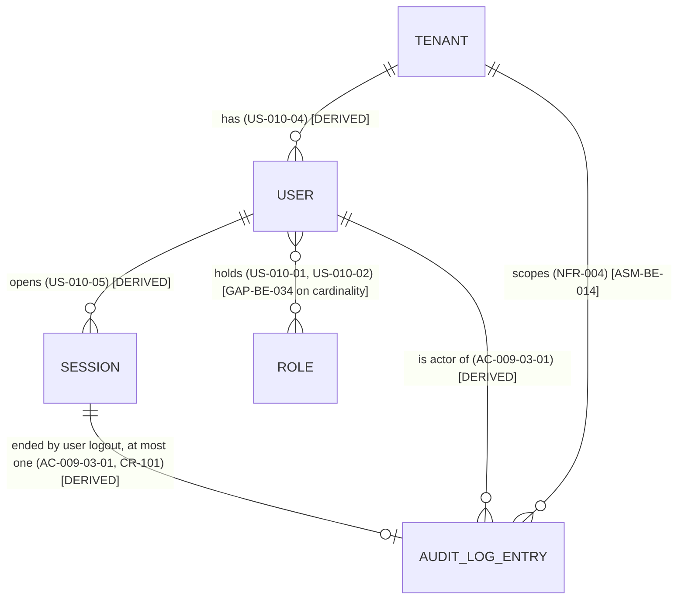

<!-- SECTION: backend.overview | status: VERIFIED -->
## Service overview

The Prooflyt backend is the system of record for a multi-tenant privacy and compliance platform. The platform's scope is set by the epic titles in `stories.md`: audit trail (EP-009), identity and access (EP-010), breach incident management (EP-011), data classification and compliance register (EP-012), data subject rights (EP-013), privacy notices (EP-014), retention and legal holds (EP-015), and processor tracking (EP-016). Tenant scoping is stated in `requirements.md` (NFR-004, "tenant-scoped").

| Epic | Responsibility | Stories | Acceptance criteria supplied |
|---|---|---|---|
| EP-009 | Audit trail: record, browse, filter, export, verify integrity | US-009-01, US-009-02, US-009-03 | US-009-03 only (AC-009-03-01..03) |
| EP-010 | Identity and access: login, session refresh, logout, roles and permission matrix, tenant users, user profile | US-010-01 to US-010-07 | None |
| EP-011 | Breach incidents: impact assessment, tasks, evidence, staff reporting | US-011-01 to US-011-04 | None |
| EP-012 | Data sources, column classification, compliance register | US-012-01 to US-012-03 | None |
| EP-013 | Data subject rights cases and tasks | US-013-01, US-013-02 | None |
| EP-014 | Privacy notice authoring, submission, approval, evidence | US-014-01 to US-014-03 | None |
| EP-015 | Retention rules and legal holds | US-015-01, US-015-02 | None |
| EP-016 | Processor DPA status and purge acknowledgements | US-016-01, US-016-02 | None |

**Current change request, CR-101 (`feedback.md`).** Record an audit log entry each time a user logs out. The preflight answer in `feedback.md` settles two questions: the entry goes to the existing audit log mechanism used for other authentication events, and only explicit user-initiated logouts are recorded. Forced and session-expiry logouts are not recorded. The change is specified in `backend.coverage` (BE-AUDIT-FR-001 to 004) and in `backend.domain-model`.

Only US-009-03 has acceptance criteria. Every other epic is represented by a story title with an empty "so that" clause. Those epics are not specified in this document beyond their responsibility statement. Their gaps are recorded as GAP-BE-037.

**Explicitly not this service's responsibility:**
- Any user interface, screen, layout or client-side rendering.
- Outbound notification, email or SMS delivery. No input describes a delivery channel, recipient or template for any event. **GAP-BE-026.** Closing artefact: a notification requirements document, or an explicit "no notifications in this release" decision.
- File and object storage for evidence uploads (US-011-03, US-014-03). No input names a storage technology or evidence rules. **GAP-BE-027.** Closing artefact: an evidence storage requirement.

<!-- /SECTION: backend.overview -->
<!-- SECTION: backend.domain-model | status: DRAFT-UNVERIFIED -->
## Domain model

Relationships marked `[DERIVED]` follow from a cited story or acceptance criterion. Relationships marked `[ASM-BE-nnn]` are working assumptions.

**Logout audit entry (CR-101).** Each successful user-initiated logout produces one `AUDIT_LOG_ENTRY` with event type `logout`. The entry records the user, the tenant and the logout timestamp (AC-009-03-01). The event type is `logout` (AC-009-03-03). The session termination and the audit entry commit together or not at all. AC-009-03-02 requires that a logout that fails to complete writes no logout audit entry, which is only possible if the two writes share a unit of work (`INV-BE-001`). The failure itself is recorded in the operational log, not the audit trail (`ASM-BE-011`).

**Entities without supplied attributes.** The following appear only as epic or story nouns: `BREACH_INCIDENT`, `DATA_SOURCE`, `COMPLIANCE_REGISTER_ENTRY`, `DSR_CASE`, `PRIVACY_NOTICE`, `RETENTION_RULE`, `LEGAL_HOLD`, `PROCESSOR`. No attributes, cardinalities or ownership rules are supplied for them, so they are not drawn. Their modelling is deferred under **GAP-BE-037**.

**ASM-BE-010.** `AUDIT_LOG_ENTRY` stores the actor and tenant as identifier values. It does not hold a live reference to the `USER` or `TENANT` module. This means the audit entry can be written from the logout path without a cyclic module dependency (see `backend.module-map`). Confirming artefact: a decision from the audit owner.

**ASM-BE-014.** Tenant scoping is assumed to apply to every audit entry. NFR-004 states tenant scoping for event streaming only. Confirming artefact: an explicit multi-tenancy policy.

**Contradiction check (core rule 8).** Four directions were checked. Story to design: the supplied design brief contains only the three AC-009-03 criteria, which match `stories.md`, so no conflict. Story to requirement: `requirements.md` repeats the US-009-03 criteria and adds BR-007 to BR-011 and NFR-003 and NFR-004, which have no conflicting content. Requirement to requirement: no conflict found. Design to design: not applicable. The identifier mismatch between the previous draft and the current inputs is recorded as **CON-BE-001** in `backend.coverage`. **CON-BE-002** records a claim in the previous draft that the design brief confirms criteria that the supplied design brief does not contain.

<!-- /SECTION: backend.domain-model -->
<!-- SECTION: backend.module-map | status: DRAFT-UNVERIFIED -->
## Module map

| Module | Boundary | Epic | Depends on |
|---|---|---|---|
| `IDENTITY` | Login, session lifecycle including logout, roles and permission matrix, tenant users, user profile | EP-010 | `AUDIT` (calls the append operation during logout, CR-101) |
| `AUDIT` | Append-only record of events, browse, filter, export, integrity verification | EP-009 | none. Actor and tenant are identifier values, not module calls (`ASM-BE-010`). |
| `BREACH` | Breach incidents, impact assessment, tasks, evidence | EP-011 | `AUDIT` |
| `DATA-CLASS` | Data sources, column classification, compliance register | EP-012 | `AUDIT` |
| `RIGHTS` | Data subject rights cases and tasks | EP-013 | `AUDIT` |
| `NOTICE` | Privacy notices, approval, evidence | EP-014 | `AUDIT` |
| `RETENTION` | Retention rules and legal holds | EP-015 | `AUDIT`, `DATA-CLASS` (`ASM-BE-004`, pending GAP-BE-017) |
| `PROCESSOR` | Processor registry, DPA status, purge acknowledgements | EP-016 | `AUDIT` |
| `SLA-SWEEP` (scheduled job, not a resource owner) | Enforces time-bound deadlines | BR-011, NFR-003 | reads `RIGHTS` and `BREACH` |

**Direction of dependency.** All dependencies run from the left-hand module to the right-hand one. `IDENTITY` depends on `AUDIT` for the logout append (CR-101). `AUDIT` does not call `IDENTITY`. This removes the two-way dependency noted in the previous draft as `ASM-BE-009`, which is narrowed by `ASM-BE-010`. Confirming artefact: the audit owner's decision on whether the logout path calls the existing append operation directly.

**Scheduled job.** `SLA-SWEEP` is a job, not an API-owning module. It has no `API-` identifiers. Its existence is stated by BR-011 ("SLA sweep job enforces time-bound case deadlines") and NFR-003 ("Automated SLA sweeping for time-bound cases"). Its schedule, deadlines and owners are not stated (GAP-BE-037).

**ASM-BE-004** (retention targets data sources) is unchanged from the previous draft and remains pending GAP-BE-017.

<!-- /SECTION: backend.module-map -->
<!-- SECTION: backend.api-surface | status: DRAFT-UNVERIFIED -->
## API surface index

No `api_docs` input was supplied, so no method, path or status code below is verified against an existing system. Each row is a design decision by this agent, derived from the story verb. Only operations with supplied acceptance criteria or a clear story verb are indexed. Other epics are deferred (GAP-BE-037).

| API ID | Method | Path | Auth | Module | Basis |
|---|---|---|---|---|---|
| `API-AUTH-002@1` | Not supplied (ASM-BE-012) | Not supplied (ASM-BE-012) | Bearer, authenticated user, own session only | IDENTITY | Logout: US-010-05, AC-009-03-01, AC-009-03-02. The audit write is a side effect of this operation (CR-101). |
| `API-AUDIT-001@1` | Not supplied | Not supplied | Bearer, Admin | AUDIT | Browse and filter the audit trail: US-009-01, US-009-02. Title only; AC-009-03-03 shows that a logout entry appears in the audit trail. |
| `API-AUDIT-002@1` | Not supplied | Not supplied | Bearer, Admin | AUDIT | Export the audit trail: US-009-01, US-009-02. Export format not stated (GAP-BE-032). |
| `API-AUDIT-003@1` | Not supplied | Not supplied | Bearer, Admin | AUDIT | Verify audit log integrity: US-009-02. Mechanism not stated (GAP-BE-033). |

**ASM-BE-012.** The logout operation's method and path are not supplied. The contract author will set them once `api_docs` or a platform decision exists. Until then the logout operation is identified only by `API-AUTH-002@1`.

**Pagination, sorting and filtering.** The three `API-AUDIT-` collection operations need pagination and filter parameters. None are specified by any input, so they are deferred to module-level specs with GAP-BE-037.

<!-- /SECTION: backend.api-surface -->
<!-- SECTION: backend.auth-model | status: DRAFT-UNVERIFIED -->
## Auth model

**No role catalogue is supplied.** US-010-01 ("Admin configures role permission matrix") and US-010-02 ("Administer roles and granular permission matrix") indicate that permissions are configurable by an administrator at runtime. No default roles or default matrix are supplied. **GAP-BE-034.** Closing artefact: a role catalogue and default permission matrix from the product owner.

**Actor nouns used in stories.** `Admin` is named in US-009-01, US-010-01, US-010-02 and US-010-04. `Compliance officer` is named in US-015-01 and US-016-01. `Handler` is named in US-013-01. `Staff` is named in US-011-04. `Author` and `Approver` are named in US-014-01 and US-014-02. Each name is taken from the story text. No permissions are attached to them beyond what the story verbs say.

**Permissions for the operations specified in this run:**

| Operation | Who may invoke it | Source |
|---|---|---|
| Logout (`API-AUTH-002@1`) | Any authenticated user, for their own session | AC-009-03-01, CR-101 |
| Audit write on logout | The system, as a side effect of logout. This is not a role and does not grant write access to `AUDIT`. | CR-101, `ASM-BE-013` |
| Audit trail browse and export (`API-AUDIT-001@1`, `API-AUDIT-002@1`) | Admin | US-009-01, US-009-02 |

**Ownership predicate for logout.** The requesting user's identifier must match the owner of the session being ended. No input states an exception, so none is assumed.

**Full permission matrix.** Every role, resource and operation cannot be written until GAP-BE-034 closes. The matrix is therefore not produced in this run.

<!-- /SECTION: backend.auth-model -->
<!-- SECTION: backend.data-lifecycle | status: DRAFT-UNVERIFIED -->
## Data lifecycle

| Data | Stored by | Retention | Encrypted at rest | Deletion |
|---|---|---|---|---|
| Audit log entries, including `logout` entries (CR-101) | AUDIT | Not stated. **GAP-BE-029.** | Not stated. **GAP-BE-029.** | Not stated. Append-only is assumed (`ASM-BE-013`). |
| Session records, ended by logout | IDENTITY | Not stated. **GAP-BE-029.** | Not stated. **GAP-BE-029.** | Ending by logout is assumed to mark the session ended (`ASM-BE-015`). Deletion is not stated. |
| Operational log entries for failed logouts (AC-009-03-02) | Operational logging | Not stated. **GAP-BE-029.** | Not stated. **GAP-BE-029.** | Not stated. |

**ASM-BE-013.** Audit entries are immutable after they are written. No input states this. The assumption is inferred from the phrase "audit trail" and from AC-009-03-03, which describes a logout entry being viewed later. Confirming artefact: an audit immutability requirement.

**ASM-BE-015.** A logout ends the session. AC-009-03-01 states that "the user logs out" and that an audit entry is written. It does not state the session's end state. Confirming artefact: a session state machine (see GAP-BE-035).

**Personal data.** The `logout` entry holds user and tenant identifiers. No input states whether those identifiers are personal data under the platform's own policy. Specific masking rules for examples are in `backend.observability`. This document does not claim that any data is encrypted, redacted or retained unless an input says so (core rule 12).

<!-- /SECTION: backend.data-lifecycle -->
<!-- SECTION: backend.nfr | status: DRAFT-UNVERIFIED -->
## Non-functional requirements

No latency, throughput, concurrency or availability target is supplied for this service. None is written here, because any figure would be invented. **GAP-BE-030.** Closing artefact: NFR targets with sources.

The two supplied NFRs with targets left blank:

| NFR | Statement | Priority | Target | Source |
|---|---|---|---|---|
| NFR-003 | Automated SLA sweeping for time-bound cases | Should | Blank | `requirements.md` |
| NFR-004 | Tenant-scoped WebSocket event streaming | Should | Blank | `requirements.md` |

Rationale and enforcement are also blank for BR-007 to BR-011, which are listed in `requirements.md`. Those blanks are recorded under **GAP-BE-038**.

**Logout path.** CR-101 states no performance requirement. The audit write is part of the logout unit of work (`INV-BE-001`). Its latency therefore affects logout latency, but no figure exists to set against it.

<!-- /SECTION: backend.nfr -->
<!-- SECTION: backend.error-model | status: BLOCKED -->
## Error model

**Blocked.** No error envelope, status-code policy or error-code registry is supplied. The logout failure in AC-009-03-02 is described as "a logout request fails to complete" but has no status code, error code or defined failure class. A global error model cannot be written without these.

**Unblocks with:**
- **GAP-BE-031.** An error envelope and error-code registry for the backend, from the platform owner.
- **GAP-BE-028.** A definition of which failures count as "a logout request fails to complete": network, validation, server, or partial completion. AC-009-03-02 does not define this.

<!-- /SECTION: backend.error-model -->
<!-- SECTION: backend.observability | status: DRAFT-UNVERIFIED -->
## Observability

**Logged.**
- A failed logout is logged (AC-009-03-02). The log is the operational log, not the audit trail (`ASM-BE-011`). The log's fields and level are not stated (**GAP-BE-029** covers retention; the log schema is not stated).
- Successful logout entries are written to the audit trail (AC-009-03-01), not to the operational log.

**Redacted.** No redaction rule is supplied. The previous draft named passport, date of birth, phone and email as PII. None of those fields appears in the logout specification. Examples in this document use placeholder identifiers only. **GAP-BE-029** covers redaction for the operational log.

**Metered.** No metric is named by any input. **GAP-BE-030** covers this together with the NFR targets.

**Alerts.** No alert is named by any input. Alerting on repeated logout failures is not specified because no threshold is supplied.

<!-- /SECTION: backend.observability -->
<!-- SECTION: backend.migration-plan | status: BLOCKED -->
## Migration plan

**Blocked.** No schema, table or column is supplied for the audit log, so no migration can be ordered or its reversibility stated.

CR-101 assumes that the existing audit log mechanism accepts an event of type `logout` without a schema change (feedback preflight answer). The feedback does not describe that mechanism. If it does not accept the event type, a migration is required.

**Unblocks with:** **GAP-BE-025.** A description of the existing audit log mechanism: its schema, its append operation, and whether it accepts an event type of `logout`.

<!-- /SECTION: backend.migration-plan -->
<!-- SECTION: backend.coverage | status: VERIFIED -->
## Coverage

### Requirements written in this run

Every requirement carries traces, a verification (named test, or `(planned)` with a proposed name) and the API it depends on.

**BE-AUDIT-FR-001.** When a user logs out successfully, the system writes one audit entry with event type `logout`, recording the user, the tenant and the logout timestamp.
- Traces to: US-009-03, AC-009-03-01, CR-101
- Verification: (planned) `logout_writes_one_audit_entry_with_user_tenant_timestamp`
- API: `API-AUTH-002@1`

**BE-AUDIT-FR-002.** When a logout request fails to complete, the system writes no logout audit entry for that request and logs the failure.
- Traces to: AC-009-03-02
- Verification: (planned) `failed_logout_writes_no_audit_entry_and_logs_failure`
- API: `API-AUTH-002@1`

**BE-AUDIT-FR-003.** A logout entry is listed in the audit trail with event type `logout`.
- Traces to: AC-009-03-03
- Verification: (planned) `logout_entry_listed_in_audit_trail_with_type_logout`
- API: `API-AUDIT-001@1`

**BE-AUDIT-FR-004.** Forced logouts and session-expiry logouts write no `logout` audit entry.
- Traces to: `feedback.md` preflight answer ("record explicit user-initiated logouts only"), CR-101
- Verification: (planned) `session_expiry_logout_writes_no_audit_entry`
- API: `API-AUTH-002@1`

**Invariants.**
- **INV-BE-001.** For a successful user-initiated logout, the session termination and the logout audit entry commit in one unit of work. Neither persists without the other. Derived from AC-009-03-01 and AC-009-03-02.
- **INV-BE-002.** No `logout` audit entry exists for a logout request that did not complete. Derived from AC-009-03-02.
- **INV-BE-003.** A forced logout or session-expiry end produces no `logout` audit entry. Derived from the preflight answer.

### Story coverage

Every supplied story is listed. Column `Covered by` names a requirement from this run. Where no requirement is named, the reason is given.

| Story | Epic | Acceptance criteria supplied | Covered by | Status |
|---|---|---|---|---|
| US-009-01 | EP-009 | None | None | Uncovered: title only (GAP-BE-037) |
| US-009-02 | EP-009 | None | None | Uncovered: title only (GAP-BE-037) |
| US-009-03 | EP-009 | AC-009-03-01, 02, 03 | BE-AUDIT-FR-001, 002, 003 | Covered |
| US-010-01 | EP-010 | None | None | Uncovered: title only; roles not catalogued (GAP-BE-034) |
| US-010-02 | EP-010 | None | None | Uncovered: title only; roles not catalogued (GAP-BE-034) |
| US-010-03 | EP-010 | None | None | Uncovered: title only (GAP-BE-037) |
| US-010-04 | EP-010 | None | None | Uncovered: title only (GAP-BE-037) |
| US-010-05 | EP-010 | None | BE-AUDIT-FR-001 covers the logout portion only | Partial: login and session refresh uncovered (GAP-BE-037) |
| US-010-06 | EP-010 | None | None | Uncovered: title only (GAP-BE-037) |
| US-010-07 | EP-010 | None | None | Uncovered: title only (GAP-BE-037) |
| US-011-01 | EP-011 | None | None | Uncovered: title only (GAP-BE-037) |
| US-011-02 | EP-011 | None | None | Uncovered: title only (GAP-BE-037) |
| US-011-03 | EP-011 | None | None | Uncovered: title only (GAP-BE-037) |
| US-011-04 | EP-011 | None | None | Uncovered: title only (GAP-BE-037) |
| US-012-01 | EP-012 | None | None | Uncovered: title only (GAP-BE-037) |
| US-012-02 | EP-012 | None | None | Uncovered: title only (GAP-BE-037) |
| US-012-03 | EP-012 | None | None | Uncovered: title only (GAP-BE-037) |
| US-013-01 | EP-013 | None | None | Uncovered: title only (GAP-BE-037) |
| US-013-02 | EP-013 | None | None | Uncovered: title only (GAP-BE-037) |
| US-014-01 | EP-014 | None | None | Uncovered: title only (GAP-BE-037) |
| US-014-02 | EP-014 | None | None | Uncovered: title only (GAP-BE-037) |
| US-014-03 | EP-014 | None | None | Uncovered: title only (GAP-BE-037) |
| US-015-01 | EP-015 | None | None | Uncovered: title only (GAP-BE-037) |
| US-015-02 | EP-015 | None | None | Uncovered: title only (GAP-BE-037) |
| US-016-01 | EP-016 | None | None | Uncovered: title only (GAP-BE-037) |
| US-016-02 | EP-016 | None | None | Uncovered: title only (GAP-BE-037) |

**Count.** 26 stories supplied. 1 covered (US-009-03). 1 partially covered (US-010-05). 24 uncovered, each for the reason given in the table.

### Gaps and assumptions raised in this document

| ID | Subject | Closing artefact |
|---|---|---|
| GAP-BE-025 | The existing audit log mechanism is named in the feedback but not described: schema, append operation, event-type support | Description of the existing audit mechanism |
| GAP-BE-026 | No notification requirement for any event | Notification requirements, or a "none in this release" decision |
| GAP-BE-027 | No evidence storage technology or rule | Evidence storage requirement |
| GAP-BE-028 | "A logout request fails to complete" is undefined | Definition of logout failure classes |
| GAP-BE-029 | No retention, encryption-at-rest, deletion or redaction rule for audit, session or operational data | Data handling requirement |
| GAP-BE-030 | No NFR targets or metrics | NFR targets with sources |
| GAP-BE-031 | No error envelope or error-code registry | Error model requirement |
| GAP-BE-032 | Audit export format not stated | Export requirement with format |
| GAP-BE-033 | Integrity verification mechanism not stated | Integrity mechanism specification |
| GAP-BE-034 | No role catalogue or default permission matrix | Role catalogue from product owner |
| GAP-BE-035 | No session state machine; logout end state and repeated logout on an ended session undefined | Session state machine |
| GAP-BE-036 | Schedule, deadlines and owners of the SLA sweep job not stated | SLA sweep requirement |
| GAP-BE-037 | 24 stories have title only and no acceptance criteria | Acceptance criteria for each story |
| GAP-BE-038 | BR-007 to BR-011 have blank rationale and enforcement | Business rule detail |
| ASM-BE-010 | Audit entry holds identifier values, not live module references | Audit owner decision |
| ASM-BE-011 | A failed logout is recorded in the operational log, not the audit trail | Confirmation of AC-009-03-02 intent |
| ASM-BE-012 | Logout method and path are not supplied | `api_docs` or platform decision |
| ASM-BE-013 | Audit entries are immutable once written | Audit immutability requirement |
| ASM-BE-014 | Tenant scoping applies to all audit entries | Multi-tenancy policy |
| ASM-BE-015 | Logout ends the session | Session state machine (GAP-BE-035) |
| CON-BE-001 | The previous draft used identifiers EP-001 to EP-008, US-001 to US-008 and CR-98, none of which appear in the current `stories.md` (EP-009 to EP-016, US-009 to US-016). Those identifiers are not carried forward. | Confirmation of which story set is authoritative |
| CON-BE-002 | The previous draft says `design-brief.md` confirms AC-002-05-01, 02 and 03 (account lockout). The supplied `design-brief.md` contains only AC-009-03-01, 02 and 03. CR-98 does not appear in the supplied feedback excerpt. The lockout behaviour is not specified in this document. | Supply the document that contains CR-98 and AC-002-05 |
| CON-BE-003 | The previous `GAPS.md` register and the previous `BACKEND-SPEC.md` assign different meanings to the same GAP-BE identifiers (for example, GAP-BE-001 is "no platform input" in the register and "notifications" in the draft). Identifiers GAP-BE-001 to GAP-BE-024 are not reused. | Reconciliation of the previous register |

**Questions.** None raised. The run is unattended, and the preflight answers settle the audit-sink and scope questions. Every other open point is recorded above as a gap or assumption.

<!-- /SECTION: backend.coverage -->
